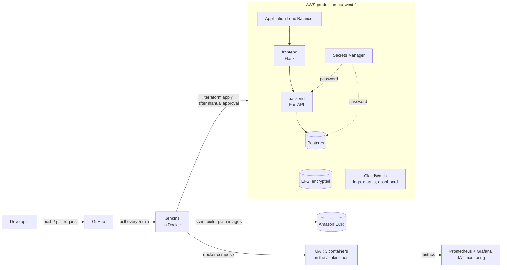

# Task Tracker: a three-tier app with a DevSecOps CI/CD pipeline to AWS

ATU, MSc DevOps, *DevOps Software Engineering*. CA3 (pipeline) and CA4 (reflection).
Student: L00205332.

A small three-tier Python application whose real subject is the **pipeline
that builds, tests, scans, packages and deploys it**: from a Git push, through
a local UAT environment and a manual approval gate, to production on AWS.

---

## Architecture



| Tier | Code | Runs as |
|---|---|---|
| Presentation | `app/frontend`: Flask + Jinja2, served by gunicorn | ECS service `tasktracker-frontend`, behind the ALB |
| Application | `app/backend`: FastAPI + SQLAlchemy | ECS service `tasktracker-backend` |
| Data | `db/`: Postgres 16 with the schema baked in | ECS service `tasktracker-db`, data on encrypted EFS |

The services find each other by private DNS (`backend.tasktracker.local`,
`db.tasktracker.local`, via AWS Cloud Map). Each tier's security group only
accepts traffic from the tier in front of it.

---

## The pipeline (`Jenkinsfile`)

| # | Stage | What it does | Fails the build when |
|---|---|---|---|
| 1 | Checkout | Clones the repo; image tag = short commit SHA | |
| 2 | Build | Backend and frontend in parallel: install, `ruff`, `black --check` | lint or format errors |
| 3 | Test | `pytest` with coverage and JUnit reports, both tiers in parallel | any test fails |
| 4 | Static analysis and security | **Bandit** (Python security), **Trivy** (dependency CVEs), **SonarQube Cloud** (code quality and coverage), **Gitleaks** (secrets in Git history), in parallel | any finding above threshold |
| 5 | Containerise | Builds 3 images, **Trivy-scans each image**, pushes to ECR | a CRITICAL CVE in an image |
| 6 | Deploy to UAT | `docker compose up` with the exact scanned images; smoke test frontend, backend and database | UAT not healthy within 60 s |
| 7 | Promotion gate | **Pauses for a human to approve** production | (manual) |
| 8 | Deploy to production | `terraform apply` with the new image tag; ECS rolling deploy with automatic rollback | apply or rollout fails |
| 9 | Post-deploy checks | Production smoke test; **fails if any CloudWatch alarm is firing**; **security check that `/metrics` is not public** | any check fails |

Scanners are **enforced**, never `|| true`: during development the image scan
blocked a release over a CRITICAL CVE (CVE-2025-68121) inside the official
Postgres image; it was fixed by removing the affected component.

---

## Security (DevSecOps)

- **Shift-left scanning** on every change (stages 2-5) and again on the built images.
- **Least-privilege CI identity:** Jenkins uses a dedicated IAM user (`infra/bootstrap`) limited to the project's ECR repositories, its Terraform state, the services it deploys in one region, and `tasktracker-*` IAM roles. No personal admin keys.
- **No secrets in code:** the database password is generated by Terraform, stored in **AWS Secrets Manager** and injected into the containers at start-up; CI credentials live in Jenkins' credential store; Gitleaks guards the history.
- **Hardened containers:** multi-stage builds, non-root users in all three tiers, minimal runtime images.
- **Network:** tier-to-tier security groups; EFS encrypted at rest and in transit; `/metrics` blocked at the load balancer.

---

## Monitoring

- **Production:** CloudWatch logs per tier, a dashboard defined in Terraform (traffic, 5xx, latency, target health, CPU and memory, alarm status, recent errors), five alarms to SNS, and the pipeline's post-deploy alarm check.
- **UAT:** Prometheus scrapes both tiers' `/metrics`; Grafana shows a provisioned dashboard; alert rules (`TierDown`, `BackendHighErrorRate`, `FrontendSlow`) in `monitoring/prometheus/alerts.yml`.

---

## Repository layout

```
app/backend/            FastAPI API, tests, multi-stage Dockerfile
app/frontend/           Flask UI, tests, multi-stage Dockerfile
db/                     Postgres image with init.sql baked in
docker-compose.yml      UAT stack (used by the pipeline's stage 6)
Jenkinsfile             The 9-stage pipeline
jenkins/                Reference copy of the Jenkins image and compose file
infra/bootstrap/        One-off Terraform: state bucket, ECR repos, Jenkins IAM user
infra/prod/             Production Terraform: VPC, ALB, ECS Fargate, EFS, secrets, monitoring
monitoring/             Prometheus + Grafana for UAT (alert rules, dashboard as code)
docs/engineering-log.md Every challenge, root cause, fix and lesson
pyproject.toml          ruff / black / bandit settings
sonar-project.properties, .gitleaks.toml   scanner settings
```

---

## Running it

**Prerequisites:** Docker Desktop, Git, Terraform 1.17, AWS CLI v2 (an AWS profile), a SonarQube Cloud project.

**The app locally** (all three tiers):

```bash
docker compose up --build
```

Then open http://localhost:5000 (UI) or http://localhost:8000/docs (API).

**UAT monitoring** (from `monitoring/`): put `GRAFANA_ADMIN_PASSWORD=...` in `monitoring/.env` (git-ignored), then:

```bash
docker compose -f docker-compose.monitoring.yml up -d
```

Prometheus is at http://localhost:9090, Grafana at http://localhost:3000.

**Jenkins:** build and run the image in `jenkins/` (it adds git, the Docker CLI, AWS CLI and Terraform to the LTS image). Then:
1. Install the plugins: Git, Pipeline, Docker Pipeline, Credentials Binding, JUnit, SonarQube Scanner, AWS Credentials.
2. Add the credentials: `aws-jenkins-ci` (AWS Credentials) and `sonarcloud-token` (Secret text).
3. Add a SonarQube server named `sonarcloud`.
4. Create a Pipeline job from SCM pointing at this repo.

**AWS, once:**

```bash
cd infra/bootstrap
terraform init
terraform apply
```

Then create an access key for the `tasktracker-jenkins-ci` user in the IAM console and store it in Jenkins as `aws-jenkins-ci`. From then on, every merge to `main` runs the pipeline, and `infra/prod` is applied by stage 8.

**Tear down** (production costs money while running):

```bash
cd infra/prod
terraform destroy -var="image_tag=x"
```

---

## Design decisions and known limitations

The key trade-offs (Jenkins vs GitHub Actions, ECS vs EKS, Postgres on EFS vs
RDS, public subnets vs NAT, HTTP vs HTTPS) and the improvement backlog are
documented, with the reasoning, in [`docs/engineering-log.md`](docs/engineering-log.md)
(sections E and F), alongside every problem met while building this.
